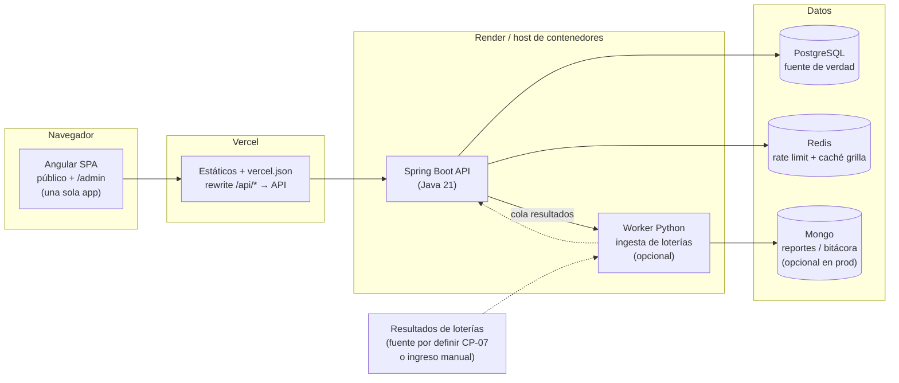

# Alex-Rifas v2 — Plan de checkpoints y mapa de arquitectura

> Base analizada: repo `Azardep00/Alex-Rifas` (backend Spring Boot + stack Docker de la materia) y el flujo de la página de referencia (reservas por número con nombre + teléfono, sorteo ligado a loterías colombianas).
> Fecha: 2026-11-02. No ejecuté `mvn test` ni levanté el stack todavía: eso es el CP-00.

---

## 1. Lo que ya tienes (verificado leyendo el repo)

| Pieza | Estado |
|---|---|
| API Spring Boot 3.5 / Java 21, capas `controller → service → repository`, DTOs como `record` | Sólida y limpia |
| Auth JWT + refresh tokens con detección de reutilización, roles `ADMIN / ORGANIZADOR / CLIENTE` | Hecho |
| Rifas: `BORRADOR → PUBLICADA → CERRADA → SORTEADA / CANCELADA`, premios, boletos numerados `0..N-1` | Hecho |
| Reserva con bloqueo pesimista (`...ForUpdate`), expiración a 15 min vía `@Scheduled` cada 30 s | Hecho |
| Confirmación de pago **manual** por admin (`/api/admin/compras/{codigo}/confirmar-pago-manual`) | Hecho |
| Sorteo `ALEATORIO` (SecureRandom), `LOTERIA`/`MANUAL` (el organizador escribe el número) | Hecho, pero manual |
| Flyway `V1` con tablas de pagos Wompi, ganadores y auditoría ya previstas | Hecho |
| Docker Compose: proxy nginx, web Flask, visor Node, worker Python, Postgres, Redis, Mongo, 3 redes | Hecho (entrega de la materia) |
| Tests JUnit de servicios (auth, compra, rifa, sorteo, JWT) | Existen; sin verificar si pasan |

## 2. Brechas contra la página de referencia (lo que realmente falta)

1. **Reserva sin cuenta.** Hoy `CompraService.reservar` exige un usuario autenticado con rol `CLIENTE`. La referencia pide solo nombre y teléfono. `compras.usuario_id` es `NOT NULL` → hay que migrar.
2. **Loterías reales.** `LOTERIA` solo guarda un texto (`loteria_nombre`); no hay tabla de loterías, ni resultados, ni regla "últimos N dígitos".
3. **Cupo vacío.** `SorteoService` exige que el número ganador sea un boleto *vendido*. Con loterías, el número puede caer en un puesto libre: falta una regla (repetir con la siguiente lotería, adjudicar al siguiente, etc.).
4. **Sin CORS** en `SecurityConfig` (solo `OPTIONS` permitido). Con Angular en Vercel hay que resolverlo (ver ADR-03).
5. **No hay endpoint de grilla** compacta (estado de cada número) pensado para pintar 100–10 000 casillas.
6. **El perfil `dev` desactiva Flyway** (`ddl-auto: create-drop` sobre H2): las migraciones nuevas **no se prueban** en los tests actuales. Hay que validarlas contra Postgres real.
7. **Sin frontend** (Flask `web` y Node `visor` son sitios de la materia; el producto real será Angular).

---

## 3. Tus preguntas, respondidas

### ¿El `pom.xml` es necesario?
Sí. Es el archivo de build de Maven: declara Java 21, Spring Boot y todas las dependencias, y el `Dockerfile` lo usa para compilar el `.jar`. Sin él no hay backend. Lo que sí puedes cuestionar es la *arquitectura* y, en ese sentido, está bien planteada: capas claras, reglas de negocio en servicios, concurrencia resuelta con locks, esquema versionado. No hay que rehacerla; hay que **extenderla**.

### Render: ¿suspender tamales y lechona?
Según la documentación oficial de Render (plan gratis):
- Un servicio web gratis **se duerme tras 15 min sin tráfico** y los servicios dormidos no consumen horas. Si nadie entra, prácticamente no cuesta.
- Cada workspace tiene **750 horas gratis al mes**. Un mes de 31 días tiene 744 h: **un solo servicio encendido 24/7 se come casi toda la cuota**. Si alguien (o un "keep-alive") lo mantiene despierto, tamales y financer compiten por esas horas, y al agotarlas Render suspende **todos** los servicios gratis hasta el mes siguiente.
- **Recomendación:** suspende manualmente tamales y lechona (Dashboard → servicio → *Suspend*). Es gratis, lo reactivas cuando quieras y te quita el riesgo de que un visitante lo despierte y gaste horas.
- Si alguno de los dos es un plan de pago, ahí sí factura mientras exista: suspéndelo sin dudar. Revisa en el dashboard qué plan tiene cada uno.

### Financer para el profesor: ¿tarda 1 min en levantar?
Sí: el despertar desde "dormido" toma **alrededor de 1 minuto** y el navegador muestra una pantalla de carga mientras tanto. Para la presentación: abre la URL del backend 2–3 minutos antes de entrar al salón. No dejes un pinger permanente: gastaría las 750 h.

### ⚠️ Revisa esto hoy
**Las bases de datos Postgres gratis de Render expiran 30 días después de crearse** (14 días de gracia para pasar a pago; después borran todo). Si la base de financerKSD es gratis y la creaste hace casi un mes, se puede morir justo antes de la presentación. Mira la fecha de expiración en el dashboard de esa base.

---

## 4. Mapa de arquitectura objetivo



**Mapa de rutas de la SPA (un solo proyecto Angular, rutas lazy):**

```
/                          Home: rifas activas
/rifa/:codigo              Detalle: premios, lotería, fecha, progreso, grilla de números
/rifa/:codigo/reservar     Checkout invitado (nombre + teléfono)
/reserva/:codigo           Estado de la reserva, cuenta regresiva, instrucciones de pago, WhatsApp
/mis-boletos               Consulta por teléfono + código
/resultados/:codigo        Ganadores y número de la lotería
/admin/login               (guard: no autenticado)
/admin                     Dashboard (guard: ADMIN | ORGANIZADOR)
/admin/rifas               Lista · /admin/rifas/nueva · /admin/rifas/:id (wizard)
/admin/pagos               Cola de reservas pendientes: confirmar / liberar
/admin/sorteo/:id          Resultado de lotería → ganador → publicar
/admin/loterias            Catálogo y resultados cargados
```

**Máquina de estados de una compra (se mantiene, se extiende a invitados):**

```
 reservar ──► PENDIENTE ──(admin confirma)──► CONFIRMADA   boletos: VENDIDO
                 │
                 ├─(vence reserva_minutos)──► EXPIRADA      boletos: DISPONIBLE
                 └─(admin libera)──────────► CANCELADA     boletos: DISPONIBLE
```

### Decisiones de arquitectura (ADR resumidas)

- **ADR-01 · No tocar `main`.** Todo en rama `v2`; `main` queda tal como se entregó. El repo tiene `docs/REPARTO-DEL-GRUPO.md`: es trabajo de grupo, avísales antes de reestructurar.
- **ADR-02 · El Compose se queda para la materia; el producto se despliega "delgado".** Producción = Angular (Vercel) + API (host de contenedores) + Postgres (+ Redis). `web` Flask y `visor` Node quedan como legado hasta que Angular los iguale; Mongo y el worker pasan a opcionales.
- **ADR-03 · Mismo origen vía rewrite de Vercel** (`/api/*` → API). Elimina CORS y simplifica el manejo de tokens. CORS explícito solo como plan B.
- **ADR-04 · Reserva de invitado** con `comprador_nombre` + `comprador_telefono` (formato +57), `usuario_id` nullable, `reserva_minutos` configurable por rifa (pago manual necesita más de 15 min). Acceso a "mi reserva" por *código + teléfono*.
- **ADR-05 · Antiabuso obligatorio** al quitar la cuenta: máximo de reservas pendientes por teléfono e IP (Redis) y, si hace falta, Turnstile/captcha. Sin esto, alguien puede bloquear toda la grilla.
- **ADR-06 · Rifas por lotería = `cantidad_boletos` potencia de 10** (100, 1000, 10 000) y `digitos` = 2, 3 o 4, para que "últimos N dígitos" mapee 1 a 1 a un boleto. Los números se muestran con ceros a la izquierda (`07`, `042`).
- **ADR-07 · Regla de cupo vacío** configurable por rifa (`regla_vacante`), documentada de cara al público antes de vender.
- **ADR-08 · Resultados de lotería con evidencia y auditoría.** Ingreso manual siempre disponible (fuente, fecha, quién lo cargó, enlace/captura). La automatización es un extra, no una dependencia. No asumo que exista una API oficial gratuita: se verifica en el CP-07.
- **ADR-09 · Cliente tipado** generado desde OpenAPI (springdoc ya está en el `pom`).

### Cambios de datos previstos

```
V2: compras      + comprador_nombre, comprador_telefono, usuario_id NULLABLE, CHECK (usuario_id IS NOT NULL OR comprador_telefono IS NOT NULL)
    rifas        + reserva_minutos (default 15), digitos, regla_vacante
V3: loterias            (id, nombre, dia_semana, hora_sorteo, activa)
    resultados_loteria  (id, loteria_id, fecha, numero_mayor, serie, fuente, evidencia_url, cargado_por, creado_en)
    rifas        + loteria_id → loterias
```

---

## 5. Checkpoints

**Reglas de ejecución (para controlar tokens y tiempo):**
- Cada CP está dimensionado para **≤ 5 min de trabajo**. Si no cierra a los ~4 min, entrego lo que haya con commit y lo anoto como "parcial" al inicio del siguiente CP.
- Un CP = un commit con mensaje `cpNN: …` y un criterio de hecho comprobable.
- Antes de cada CP, sin releer el repo completo: solo los archivos listados.
- "Entrega mínima" = lo que cuenta como avance si me corto a mitad.

### Fase 0 — Cimientos
| CP | Objetivo | Criterio de hecho | Entrega mínima |
|---|---|---|---|
| **00** | Rama `v2`, tag `v1-entrega`; correr `mvn test` y `docker compose config` | Reporte de tests (verdes/rojos) y estado del stack | Lista de tests rojos |
| **01** | Guardar este plan + ADRs en `docs/` | `docs/PLAN-V2.md` en la rama | El archivo |

### Fase 1 — Backend público (sin cuenta)
| CP | Objetivo | Criterio de hecho | Entrega mínima |
|---|---|---|---|
| **02** | Migración V2 (invitado, `reserva_minutos`, `digitos`, `regla_vacante`) + entidades | Flyway aplica sobre Postgres real (no H2) | SQL + entidades compilando |
| **03** | `POST /api/publico/reservas` y `GET /api/publico/reservas/{codigo}?telefono=` reutilizando los locks existentes | Tests: reserva ok, número ocupado, límite por compra, concurrencia | Endpoint + 2 tests |
| **04** | `GET /api/rifas/{codigo}/boletos` compacto + caché corta en Redis | Responde 100 y 10 000 números < 200 ms local | Endpoint sin caché |
| **05** | Antiabuso: tope de pendientes por teléfono/IP, validación de teléfono +57 | Test del tope; 429 con mensaje claro | Tope por teléfono |
| **06** | Admin: listar compras por estado, liberar (`cancelar`), resumen de rifa (recaudo, % vendido) | Tests de autorización y de transición de estados | Listado + liberar |

### Fase 2 — Loterías
| CP | Objetivo | Criterio de hecho | Entrega mínima |
|---|---|---|---|
| **07** | Spike: fuentes de resultados de loterías colombianas (oficial, terceros, scraping, manual) y riesgos legales/de términos | Informe de 1 página con recomendación | Lista de fuentes con pros/contras |
| **08** | Migración V3 + CRUD admin de loterías y resultados (ingreso manual con auditoría) | Tests + registro en `auditoria_eventos` | Tablas + alta de resultado |
| **09** | `sortear-por-loteria`: ganador = últimos N dígitos; aplica `regla_vacante`; valida `cantidad_boletos` potencia de 10 | Tests por regla, incluido cupo vacío | Camino feliz |
| **10** | *(Opcional)* Ingesta automática del resultado (job o worker), idempotente | Reprocesar no duplica; fallo → cae a manual | Job que no rompe nada |

### Fase 3 — Angular: cara pública
| CP | Objetivo | Criterio de hecho | Entrega mínima |
|---|---|---|---|
| **11** | Scaffold Angular (standalone + signals), `vercel.json` (rewrite SPA y `/api`), tokens de diseño, cliente OpenAPI | `ng build` y deploy de prueba en Vercel | Proyecto que compila |
| **12** | Home + detalle de rifa (premios, lotería, fecha, barra de progreso) | Navegable con datos reales del API | Lista de rifas |
| **13** | Grilla de números (libre/reservado/vendido, selección múltiple, refresco cada ~10 s) + carrito flotante | Selecciona y ve total; accesible por teclado | Grilla estática |
| **14** | Checkout invitado + pantalla de reserva con cuenta regresiva, instrucciones de pago y botón WhatsApp | Flujo completo reserva → pantalla | Formulario + llamada al API |
| **15** | "Mis boletos" (teléfono + código) y página de resultados/ganadores | Consulta y muestra ganadores | Una de las dos |

### Fase 4 — Angular: administración (misma app)
| CP | Objetivo | Criterio de hecho | Entrega mínima |
|---|---|---|---|
| **16** | Login admin, guards por rol, interceptor JWT + refresh, layout `/admin` lazy | Un CLIENTE no entra a `/admin` | Login + guard |
| **17** | Dashboard + wizard de rifa (datos → premios → lotería → publicar) | Crea y publica una rifa desde la UI | Formulario de datos |
| **18** | Cola de pagos: confirmar/liberar, búsqueda por teléfono o número | Confirma una reserva y la grilla se actualiza | Tabla + confirmar |
| **19** | Sorteo en UI: elegir resultado de lotería, previsualizar ganador, confirmar y publicar | Rifa pasa a `SORTEADA` y `/resultados` la muestra | Previsualización |

### Fase 5 — Producción
| CP | Objetivo | Criterio de hecho | Entrega mínima |
|---|---|---|---|
| **20** | Perfil `prod` de la API, variables, Postgres externo, CI (GitHub Actions: `mvn test` + `ng build`), pantalla "despertando el servidor" | Deploy verde de punta a punta | Workflow de CI |
| **21** | Hardening: CSP y headers en Vercel, e2e Playwright del flujo crítico, plan de respaldos | Test e2e: reservar → confirmar → ver ganador | Un e2e |
| **22** | *(Opcional)* Wompi (webhook con verificación de firma) y notificaciones | Pago aprobado confirma la compra solo | — |

**Ruta crítica mínima para "ya funciona como la referencia":** 00 → 02 → 03 → 04 → 11 → 12 → 13 → 14 → 16 → 18.

---

## 6. Riesgos y notas

- **Legal:** en Colombia las rifas están reguladas y requieren autorización de la entidad competente (el esquema ya trae `numero_autorizacion` y `entidad_autorizadora`). No soy abogado: si esto va a operar con dinero real, valida el permiso antes de vender un solo boleto. Para la materia, deja claro que es demostración.
- **Cold start (~1 min)** afecta la primera visita: la SPA debe mostrar un estado de "despertando servidor" en vez de un error.
- **Pagos manuales** dependen de una persona: la cola de pagos (CP-18) y la expiración configurable son críticas para que no se pierdan ventas.
- **Número ganador en puesto libre:** sin `regla_vacante` publicada, es fuente de conflictos con compradores.
- **Estado de los tests sin verificar:** no asumo que `mvn test` pase hasta correrlo en el CP-00.

## 7. Siguiente paso
Lanzar el **CP-00**. Dos decisiones que necesito de ti antes del CP-02:
1. ¿Cuántas horas/minutos de reserva por defecto para pago manual (propongo 60 min)?
2. ¿La regla de cupo vacío por defecto: "repetir con la siguiente lotería" o "adjudicar al siguiente número vendido"?

---
Fuente de los datos de Render: [Render — Deploy for Free](https://render.com/docs/free)
